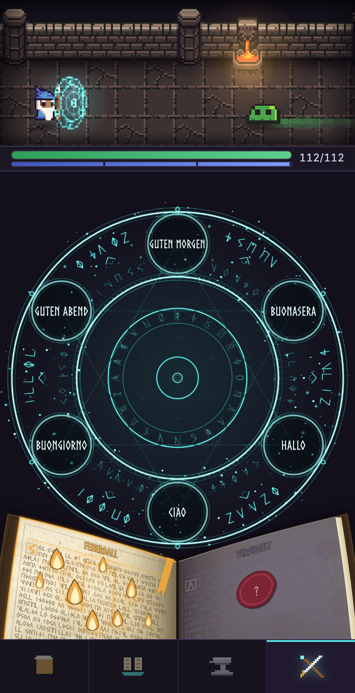
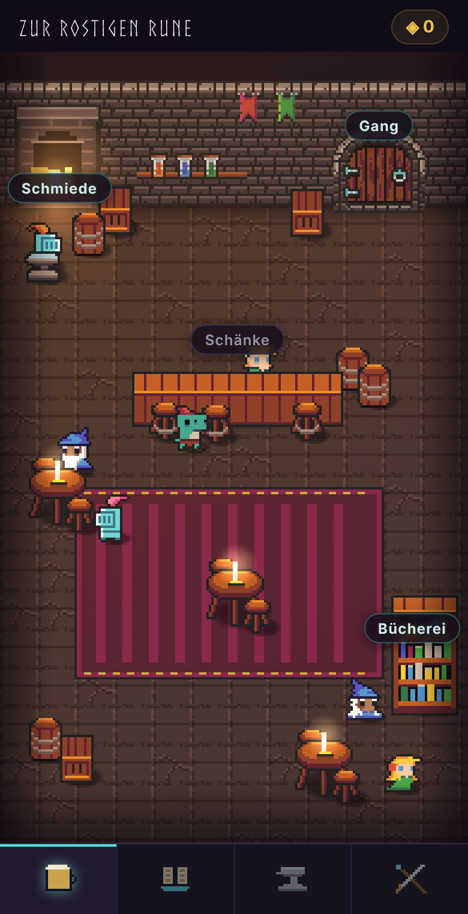

## Luca Frey

Physics M.Sc. student at KIT. I work on machine learning for magnetic materials: generating crystal structures with symmetry-aware Bayesian Flow Networks, and computing exchange couplings and Curie/Néel temperatures with high-throughput DFT.

### Open source

- **atomate2** [#1528](https://github.com/materialsproject/atomate2/pull/1528) (in review): exchange workflow that fits Heisenberg Jij to the DFT energies of magnetic orderings and runs VAMPIRE Monte Carlo to obtain critical temperatures. Resolves [#1404](https://github.com/materialsproject/atomate2/issues/1404).
- **pymatgen** [#4700](https://github.com/materialsproject/pymatgen/pull/4700): `HeisenbergMapper` support for orderings with mixed supercells
- **pymatgen** [#4699](https://github.com/materialsproject/pymatgen/pull/4699): whole-motif flip strategy for `MagneticStructureEnumerator`
- **jobflow-remote** [#498](https://github.com/Matgenix/jobflow-remote/pull/498): `--latest-flow` option for `jf job list`

### HPC tooling

[Cluster Tunnel for VS Code](https://marketplace.visualstudio.com/items?itemName=AiMatGroup.cluster-tunnel) shows your Slurm jobs across all your clusters inside VS Code. It builds on [ctun](https://github.com/aimat-lab/cluster-tunnel), which I also contribute to.

### Incanto

A roguelite I'm building to learn Italian: match word pairs on the rune circle to cast spells, then spend your gold in the tavern. [Play it on your phone](https://luguza.github.io/Incanto/), it also works offline.

  
  &nbsp;
  

